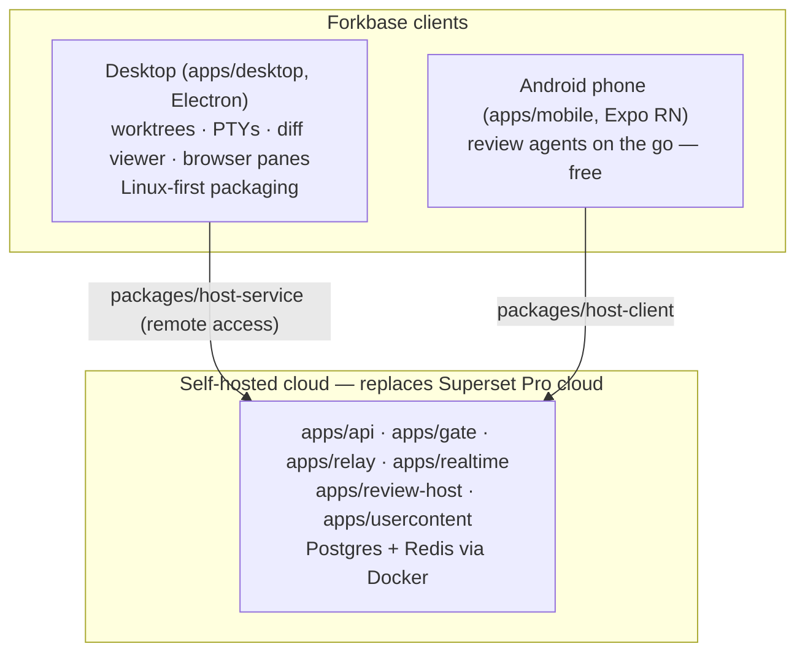
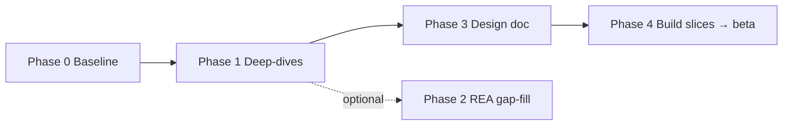

# Forkbase build plan (v1)

Date: 2026-10-14 · Status: active
Inputs: [decisions 0001](../decisions/0001-foundation.md) · [recon evidence](../research/2026-10-14-superset-recon.md)

## 1. What forkbase is

A fork of [superset-sh/superset](https://github.com/superset-sh/superset) (agentic IDE, Elastic License 2.0) taken in its own direction — **the Linux-first, free-mobile Superset** — published as an open beta.

Four pillars: **rebrand** (scripted white-label patch) · **first-class Linux desktop** · **free Android** (enable the in-repo Expo app) · **self-hosted cloud** (no Pro gate).

## 2. Architecture (planned; wiring to confirm in Phase 1)

Unverified: the exact request flow phone → cloud → desktop is a Phase 1b deliverable (KNOWN-GAPS #2).

## 3. Phases

### Phase 0 — Baseline
**Exit: forkbase dev app boots from source on Linux.**

1. ✅ Done 2026-10-14 — fork created: [github.com/mrvigneshvt/forkbase](https://github.com/mrvigneshvt/forkbase).
2. ✅ Done 2026-10-14 — cloned (now at `~/Workspace/Projects/personal/forkbase`); remotes: `origin` (fork) + `upstream` (superset-sh/superset). Next: verify prereqs — `bun` (pinned in upstream `.bun-version`), `docker`, `jq`, `gh`.
3. `./.superset/setup.local.sh` — brings up local Postgres + neon-proxy + Redis via Docker, seeds the dev account (upstream README: "Sign in as dev", or `admin@local.test` / `supersetdev`; no third-party credentials needed).
4. `bun run dev` — verify the dev desktop app runs alongside the installed AppImage (setup.local.sh assigns per-workspace identity/ports for exactly this).
5. Docs sweep: `https://docs.superset.sh/llms-full.txt`, `DEVELOPMENT.md`, `CONTRIBUTING.md`.
6. Rebrand inventory: enumerate hardcoded references (app names, bundle IDs, update feed, telemetry/crash reporting, store listings).
7. Deliverable: monorepo map + a dev-boot runbook added to this agent-context.

### Phase 1 — Deep-dives (source-first)
**Exit: subsystem maps + blocker lists for all four pillars.**

| Track | Scope | Key questions |
|---|---|---|
| a — Pro gate | `apps/gate`, `packages/auth`, `packages/cloud-client` | Where do Pro/mobile checks live? What does a self-hosted account model need? |
| b — Remote chain | `packages/host-service`, `host-client`, `apps/relay`, `apps/realtime`, `apps/api` | How does a phone reach a desktop host? What must self-hosting serve? |
| c — Linux audit | `apps/desktop`, `packages/*` | All `process.platform` macOS branches; packaging configs; `/proc`-based replacement for `macos-process-metrics`; Wayland/Hyprland concerns (tray, notifications, deep links, auto-update). Plus the author's daily AppImage pain log as the spec. |
| d — Android audit | `apps/mobile` | iOS-only assumptions (`config-plugins/`, `targets/agentactivity`, certs, push, `store.config.js`); `expo run:android` triage list. |

Method: normal repo tools; optionally `codegraph init` in the clone (author-controlled decision — agents must not index on their own). Cross-check claims against the live `~/.superset/` state read-only (never touch `auth-token.enc` or any secrets).

### Phase 2 — REA gap-fill (optional)
**Exit: answers only the source can't give.**

- Shipped AppImage 1.37.0 vs repo `main` — what Pro bits ship compiled in (ASAR analysis of the extracted AppImage).
- Passive desktop↔cloud observation to confirm the relay protocol — own traffic, credentials excluded.

### Phase 3 — Design doc
**Exit: a plan a fresh agent can execute cold.**

Build slices, beta definition, self-host deployment story (docker compose), Android distribution (APK first, Play later), license headers (D6), hard-fork timing (D7).

### Phase 4 — Build slices (each independently shippable; TDD for behavior changes; when tracks compete, M2 Linux wins — [D9](../decisions/0001-foundation.md))

1. Rebrand patch green + dev boot.
2. Linux slice 1: packaging (AUR/Flatpak/deb) + `linux-process-metrics` (`/proc`-based).
3. Un-gate + self-host stack (local accounts).
4. Android enablement: `expo run:android` → fixes → EAS build.
5. E2E: phone ↔ self-hosted cloud ↔ Linux desktop.

## 4. Fork discipline rules (binding)

From [D7](../decisions/0001-foundation.md): seams not edits · rebrand = one rebasable patch script · conscious hard-fork moment · generic Linux fixes go upstream.

## 5. Risks

| Risk | Reality check | Mitigation |
|---|---|---|
| Fork maintenance treadmill | Upstream ships daily; ~500 open PRs at recon | D7 discipline; upstream PRs shrink the diff |
| Android ≠ free enablement | iOS patches + native modules are real porting work — weeks not days | Phase 1d inventory before estimating |
| Auth/self-host is the crux | Mobile presumes upstream cloud accounts (unverified) | Phase 1a/1b before any auth build slice |
| License constraints | Inherited code can't become MIT; repackaged-fork-as-service prohibited | D6; own additions carry own license |
| Linux Electron quirks | Wayland/tray/notification bugs may be invisible upstream | Pain log; upstream what upstream accepts |

## 6. Beta definition (draft — refine in Phase 3)

Forkbase beta = desktop app (Linux packages + AppImage) + free Android APK + self-host compose, all published under ELv2 (+ own license for new code), rebrand applied, Pro gate removed in self-host mode.